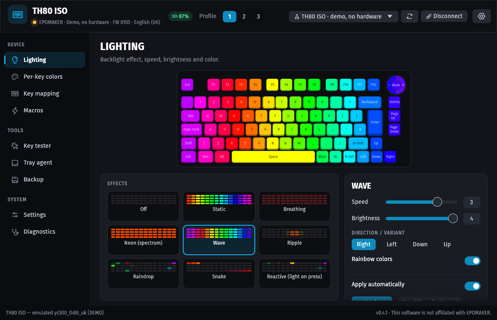
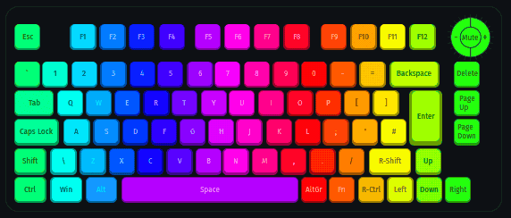
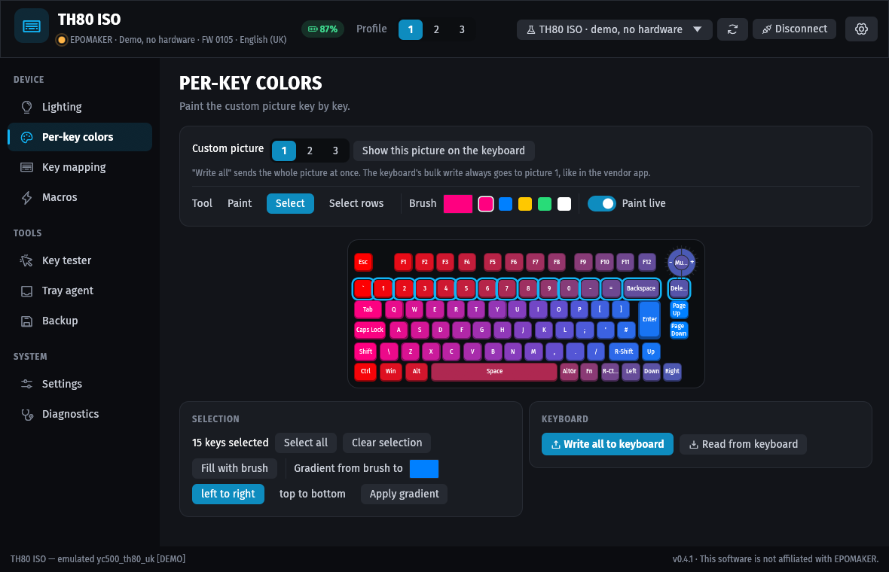
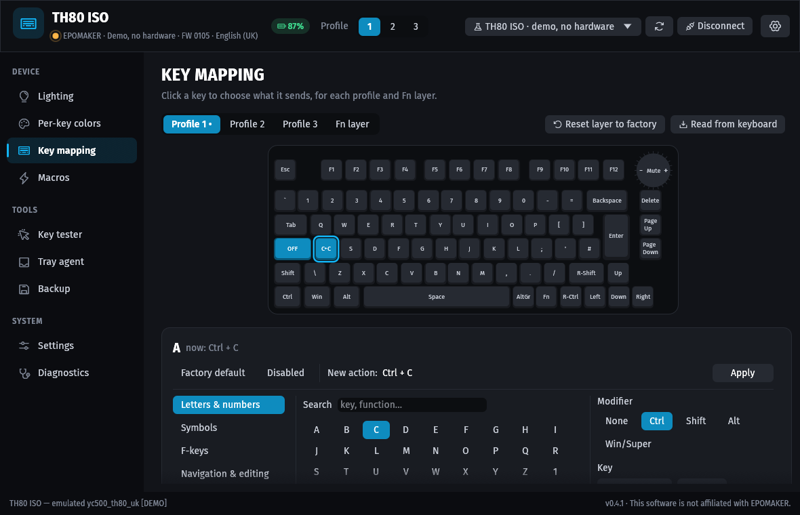
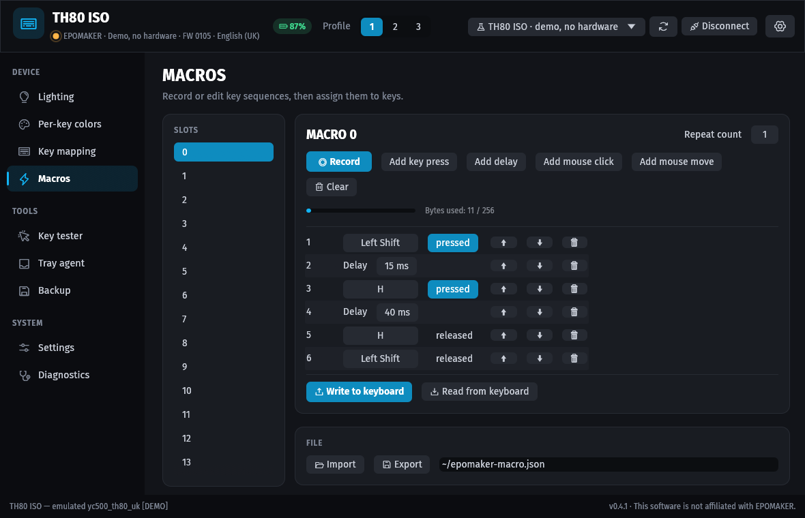
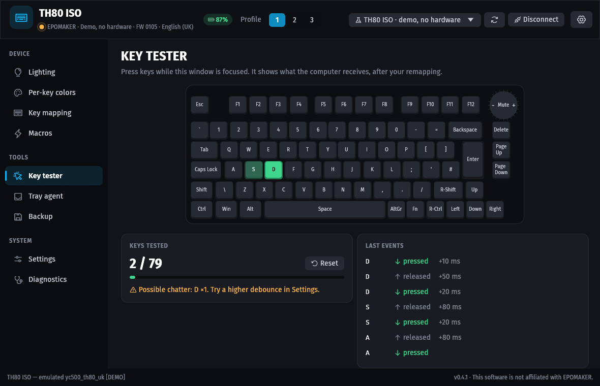
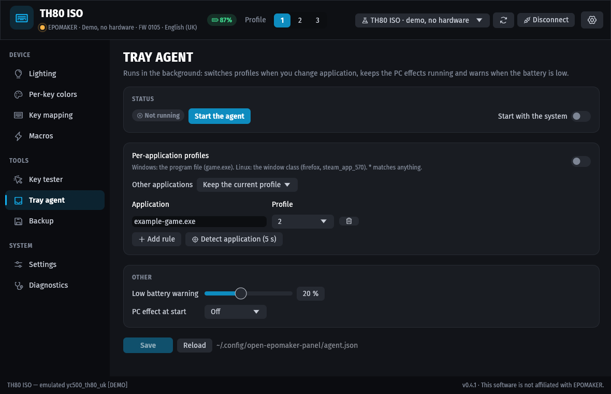
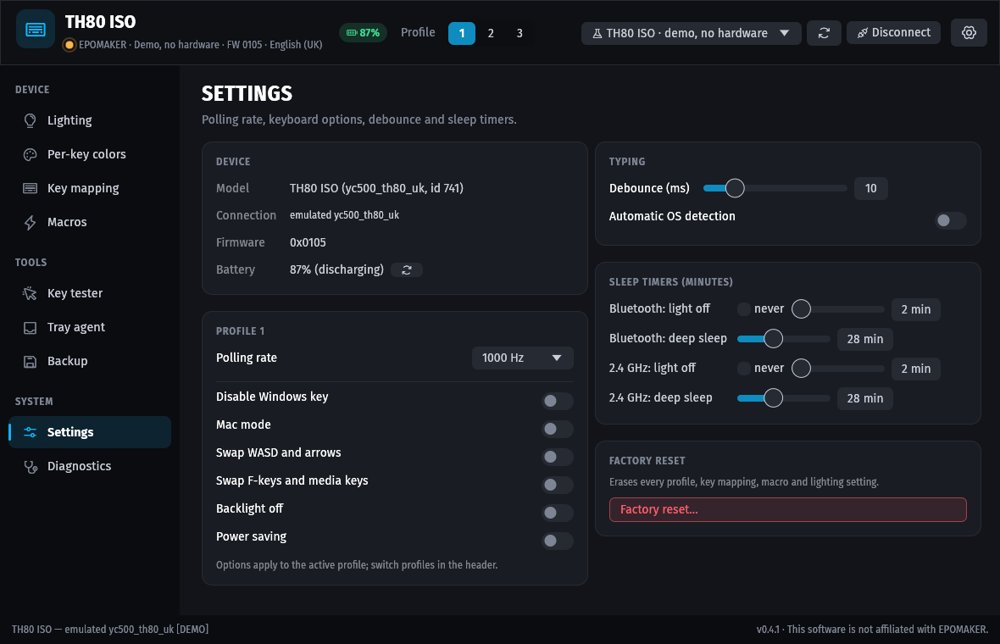
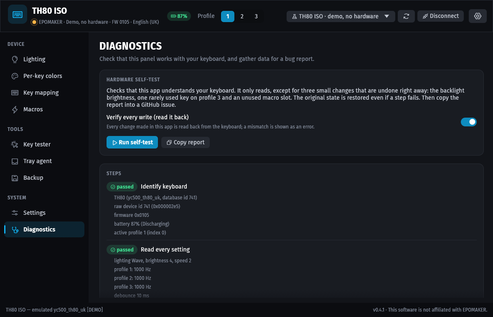
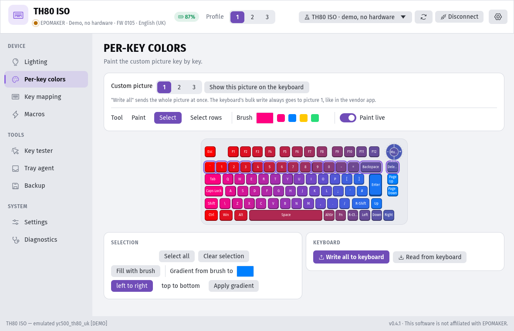

# Open Epomaker Panel

An open-source control panel for **EPOMAKER** keyboards on **Linux and Windows**, written in
Rust. It is a replacement for the official "EPOMAKER Driver" for the EPOMAKER keyboards built
on the RongYuan YC500 platform (see [Supported keyboards](#supported-keyboards)).

> 🇪🇸 Spanish version: [README.es.md](README.es.md)

> **Status:** the protocol was reverse engineered from the official software and is checked
> byte-for-byte against it (2,359 test vectors across 5 models). It has been **tested on a
> real TH80 ISO Pro** (wired, Windows): reading every setting, lighting and macros work;
> other models have not been tried on hardware yet. Make a backup
> (`epomaker backup before.json`) before changing anything. This project is not affiliated
> with EPOMAKER.

<p align="center">
  
</p>
<p align="center">
  <br>
  <sub>Every effect is previewed live on a drawing of your keyboard before it is sent.</sub>
</p>

## Features

| | GUI | CLI |
|---|---|---|
| Detect the keyboard model (firmware id) | ✅ | ✅ |
| Lighting: 19 effects, speed, brightness, direction, color, rainbow | ✅ | ✅ |
| Per-key RGB (custom effect), paint with the mouse | ✅ | ✅ |
| Key remapping on the 3 profiles and the Fn layer (keys, combos, mouse, media, macros) | ✅ | ✅ |
| Macros (50 slots): editor, recording, repeat / toggle / hold modes | ✅ | ✅ |
| Profiles, polling rate, Win-lock, Mac mode, WASD/arrow swap, Fn swap… | ✅ | ✅ |
| Debounce, wireless sleep timers, automatic OS detection | ✅ | ✅ |
| Full backup / restore to JSON, factory reset | ✅ | ✅ |
| Demo mode with an emulated keyboard (no hardware needed) | ✅ | ✅ |
| Music-follow and screen-color effects (streamed from the PC) | ✅ | ✅ |
| CPU load bar on the number row (software effect) | ✅ | ✅ |
| Macro library: export/import macros as files, automatic free slot | ✅ | ✅ |
| Key tester with switch-chatter detection | ✅ | |
| Tray agent settings: per-application rules, start with the system | ✅ | |
| JSON output and shell completions | | ✅ |
| Hardware self-test with a report for GitHub issues, verify-after-write | ✅ | ✅ |
| Hotplug: connects when the keyboard is plugged in, remembers the last one | ✅ | |

The **tray agent** (`epomaker-agent`) runs in the background: switches the onboard profile
when the focused application matches a rule, keeps the music / screen / CPU effects
running, warns when a wireless keyboard's battery is low and reconnects automatically.

Not implemented on purpose: firmware updates and TH80 X screen uploads.

## Screenshots

<table>
  <tr>
    <td width="50%" valign="top"><br><b>Per-key colors</b> — Paint keys, select boxes or rows, fill them or apply gradients.</td>
    <td width="50%" valign="top"><br><b>Key mapping</b> — Click a key and pick its new action: keys, shortcuts, media, mouse, macros.</td>
  </tr>
  <tr>
    <td width="50%" valign="top"><br><b>Macros</b> — Record or edit key sequences, delays and mouse actions; export them as files.</td>
    <td width="50%" valign="top"><br><b>Key tester</b> — See what every key sends and spot switch chatter.</td>
  </tr>
  <tr>
    <td width="50%" valign="top"><br><b>Tray agent</b> — Switch profiles per application, keep PC effects running, low-battery warnings.</td>
    <td width="50%" valign="top"><br><b>Settings</b> — Polling rate, per-profile options, debounce and sleep timers.</td>
  </tr>
  <tr>
    <td width="50%" valign="top"><br><b>Diagnostics</b> — Hardware self-test with a report ready for a GitHub issue.</td>
    <td width="50%" valign="top"><br><b>Light theme and accent colors</b> — Dark, light or system theme, five accent colors, keycap legends for your layout.</td>
  </tr>
</table>

<sub>Screenshots of the demo keyboard (a TH80 ISO emulated in software), so they can be regenerated: `EPOMAKER_AUTOSHOT_SET=readme EPOMAKER_AUTOSHOT_MODEL=741 EPOMAKER_AUTOSHOT=<dir> cargo run -p epomaker-gui --features autoshot`.</sub>

## Supported keyboards

Wired (USB) and 2.4 GHz dongle connections are supported for every model. Each one is
checked against byte vectors recorded from the official software. Tested on hardware so far:
TH80 ISO Pro (id 741, wired). Self-test reports for other models are very welcome.

| Model | Firmware id (wired) | `--demo-model` |
|---|---|---|
| TH80, TH80 Pro | 1118, 742 | `1118` |
| TH80 SOC | 1091 | `1091` |
| TH80 SE | 886 | `886` |
| TH80 X (screen not supported) | 928 | `928` |
| TH80 ISO (UK, Spanish… legends) | 741 | `741` |
| TH96 | 834 | `834` |
| TH68 | 988 | `988` |
| TH-21 (numpad) | 789 | `789` |
| EP84 | 1081 | `1081` |

Other YC500 models (e.g. RT100, which has a screen) can be added from the official
software's data; see [docs/REVERSE_ENGINEERING.md](docs/REVERSE_ENGINEERING.md#adding-another-yc500-keyboard).

## Download

Ready-made packages are attached to every [GitHub release](https://github.com/blzkz/open-epomaker-panel-control/releases):

| System | Package |
|---|---|
| Windows 10/11 | `open-epomaker-panel-windows-x86_64.zip`: unzip and run `epomaker-panel.exe` |
| Debian, Ubuntu, Mint, Pop!_OS | `.deb`: `sudo apt install ./open-epomaker-panel_*_amd64.deb` |
| Fedora, RHEL, openSUSE | `.rpm`: `sudo dnf install ./open-epomaker-panel-*.x86_64.rpm` (or `zypper install`) |
| Arch, Manjaro, EndeavourOS, CachyOS | `.pkg.tar.zst`: `sudo pacman -U open-epomaker-panel-*.pkg.tar.zst`, or build `packaging/arch/PKGBUILD` |
| Any Linux | `open-epomaker-panel-x86_64.AppImage` (portable) or the `.tar.gz` with `linux/install.sh` |

The deb, rpm and Arch packages also install the udev rule that gives your user access to
the keyboard. With the AppImage, install `packaging/linux/70-epomaker.rules` yourself (see
below). Linux builds need glibc 2.35 or newer (Ubuntu 22.04+, Debian 12+, Fedora 36+…).

## Build from source

### Compile

You need Rust ≥ 1.88. On Linux you also need `libudev` development files (Debian/Ubuntu:
`sudo apt install libudev-dev libxkbcommon-dev libgl1-mesa-dev libwayland-dev`).

```bash
cargo build --release
```

This builds `target/release/epomaker-panel` (GUI) and `target/release/epomaker` (CLI).

### Linux permissions (only when not using a package)

Regular users cannot open HID devices by default. Install the udev rule (and the
binaries and desktop entry) with:

```bash
packaging/linux/install.sh
```

Or only the rule: `sudo cp packaging/linux/70-epomaker.rules /etc/udev/rules.d/`, then
replug the keyboard.
When the GUI cannot open the keyboard because of permissions, it offers to install the
rule for you (through `pkexec`, which asks for your password).

### Windows

No driver is needed. Run `epomaker-panel.exe`. Close the official EPOMAKER software
first so both programs don't talk to the keyboard at the same time.

## Usage

### GUI

Run `epomaker-panel`. It connects on its own when a supported keyboard is plugged in (the
last one used is preferred) and shows *Keyboard disconnected* when it is unplugged. You can
also pick a keyboard (or a **demo keyboard**) and click *Connect*. The tabs are:

- **Lighting**: pick an effect from the cards and watch an animated preview on the
  keyboard drawing before (or while) it is applied.
- **Key mapping**: click a key (the rotary knob is drawn as a dial with -, press and +
  zones), then choose its new action in a searchable picker grouped by category.
- **Per-key colors**: paint keys, select boxes or rows, fill them or apply a gradient,
  and pick which of the three custom pictures you edit. The bulk "Write all" always
  targets picture 1, like the vendor app; pictures 2 and 3 are written key by key.
- **Macros**: editor, recording, mouse moves, export/import as files.
- **Key tester**: what the computer receives from each key, with chatter detection.
- **Tray agent**: per-application rules and start-with-system for `epomaker-agent`.
- **Settings**, **Backup** and **Diagnostics**.

The header shows the keyboard, its battery and the active profile (click 1, 2 or 3 to
switch). The *Preferences* menu (gear icon) switches between English and Spanish,
dark/light/system theme, the accent color, the keycap legends and the interface size.
These settings, the window size and the last keyboard are remembered.

**Keycap legends:** the firmware cannot tell national layouts apart — an ISO Spanish
TH80 reports the same model as the ISO UK one, because the keys are physically the same.
The panel therefore prints the legends of the system keyboard layout (Spanish, UK, US,
Latin American, Portuguese, German, French or Italian); pick another one in *Preferences*.

The **Diagnostics** tab runs the hardware self-test (see below) step by step and has a
*Copy report* button that puts a Markdown report on the clipboard, ready to paste into a
GitHub issue: app version, model and raw device id, firmware, USB ids and interface, the
result of every step and the raw `probe` output. The same tab holds the **Verify every
write** switch (on by default): every change made in the app is read back from the
keyboard and a mismatch is shown as an error. Without a keyboard, the tab runs the
read-only probe instead, for keyboards that are not detected.

### CLI

```bash
epomaker probe                                   # read-only diagnostics (start here)
epomaker selftest --yes                          # reversible self-test, prints a report
epomaker info
epomaker light modes
epomaker light set wave --option left --speed 3 --color ff0080
epomaker keymap set "Caps Lock" disable
epomaker keymap set A key:ctrl+c --layer p1
epomaker keymap set F1 fn:play-pause --layer fn0
epomaker macro set 0 "down:LeftShift down:H delay:30 up:H up:LeftShift" --repeat 1
epomaker keymap set F5 macro:0:toggle
epomaker color set Esc ff0000
epomaker backup my-th80.json
epomaker live music --meter                      # lights follow the PC's audio (Ctrl+C stops)
epomaker live screen                             # average screen color (Windows, Linux X11)
epomaker live cpu                                # CPU usage bar on the number row
epomaker macro export 0 hello.json
epomaker macro import hello.json --bind F5 --mode toggle
epomaker --json info                             # machine-readable output
epomaker completions bash > ~/.local/share/bash-completion/completions/epomaker
epomaker --demo info                             # anything works on the emulator too
```

Use `epomaker keymap actions` to list key, mouse and function names, `--trace` to
print every report sent to the keyboard and `--verify` to read every write back (the
command fails if the keyboard did not store the value).

### Tray agent

`epomaker-agent` (or *Open Epomaker Agent* in the applications menu) adds a tray icon with
the active profile, battery, live effects and per-application profiles. Rules live in
`~/.config/open-epomaker-panel/agent.json` (Windows: `%APPDATA%\open-epomaker-panel\agent.json`):

```json
{
  "per_app_profiles": true,
  "default_profile": 1,
  "rules": [
    { "app": "steam_app_*", "profile": 2 },
    { "app": "code", "profile": 3 }
  ],
  "battery_warning_percent": 20,
  "live_effect": null
}
```

`app` is the executable name on Windows (`game.exe`) and the window class on Linux
(`firefox`, `steam_app_570`); `*` is a wildcard. Focus tracking works on Windows, on Linux
X11 sessions and on KDE Plasma (also Wayland, through a small KWin script). Music needs
`parec` (PulseAudio/PipeWire) on Linux. On Wayland the screen color uses the desktop's
screen-sharing portal (asked once) and GStreamer's PipeWire plugin. While the control panel
is open the agent lets go of the keyboard. The *Tray agent* tab of the panel edits the rules
and the agent picks up changes by itself.

## Project layout

```
crates/epomaker-core   protocol, device database, HID transport, firmware emulator
crates/epomaker-host   PC-side integrations: audio/screen capture, focused app, CPU usage
crates/epomaker-cli    `epomaker` command line tool
crates/epomaker-agent  `epomaker-agent` tray agent
crates/epomaker-gui    `epomaker-panel` desktop app (egui)
docs/PROTOCOL.md       the wire protocol
docs/REVERSE_ENGINEERING.md   how it was obtained, how to add more models
tools/re-harness       scripts that run the vendor's code against a fake keyboard
```

## How it was done

The official installer is an Electron app plus a small Rust service (`iot_driver.exe`).
The command layer was read from the JavaScript bundle. The original classes were then
executed under Node against a fake device to record the exact bytes they send
(`tools/re-harness`). The checksum and model-identification logic in the native service
were recovered with objdump and Ghidra. See [docs/REVERSE_ENGINEERING.md](docs/REVERSE_ENGINEERING.md).

No vendor code or binaries are included in this repository. The `vendor/` directory is
git-ignored.

## Testing on real hardware

If you own one of the keyboards above (or another EPOMAKER YC500 keyboard), please help:

1. `epomaker probe` and share the output.
2. `epomaker selftest --yes` (or *Run self-test* in the GUI's Diagnostics tab) and paste
   the report into a GitHub issue.
3. `epomaker info`, then try a lighting change (`epomaker light set breath --color 00ff00 --verify`).
4. Back up before remapping keys: `epomaker backup before.json`.

The self-test only reads, except for three small writes that are undone right away: the
backlight brightness is lowered by one step and the original effect written back, a rarely
used key (Pause, Scroll Lock, right Ctrl…) on **profile 3** is remapped to F13 and restored,
and an unused macro slot (preferably empty, never one bound to a key) is written, read back
and emptied. Every write is verified, and each step restores the original state even when
it fails; a restore that does not stick is reported as *not restored*, with the original
value, so it can be fixed by hand.

Failed USB transfers are retried a few times with growing pauses (the firmware briefly
stops answering while it saves settings). If writes still fail, run with
`EPOMAKER_PACING=2` (or `3`) to make every pause between reports longer and tell us
whether it helps.

## License

[MIT](LICENSE). Not affiliated with or endorsed by EPOMAKER.
